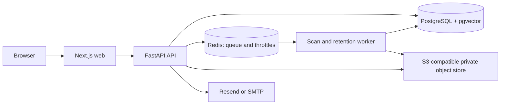

# BrandLens architecture

## Runtime

The App Router web application serves the public marketing pages and authenticated organisation UI. Its product routes forward requests to the FastAPI service. The API owns authentication, tenant membership, source evidence, rules, campaigns, assets, findings, reviews, audit records, export/deletion and notifications. PostgreSQL is the source of truth; migrations live in `api/alembic`. Redis provides shared rate-limit counters and the background scan queue. The separate Python worker runs scans and retention work. User files are private object storage objects addressed through random keys and short-lived signed URLs.

Production builds are `Dockerfile.web` and `api/Dockerfile`; the API image also runs the worker with a different command. `compose.production.yaml` runs a one-shot Alembic migration service before API and worker services and checks API readiness plus web liveness. It expects managed PostgreSQL with pgvector, Redis, S3-compatible storage and a TLS reverse proxy. The native development launcher uses local PostgreSQL, Redis and Mailpit containers with private files under `api/private-uploads`; the full development Compose stack stores uploads in a private Docker volume and publishes its ports on loopback only.

## Evidence and scanning

Exact phrase, offer/date, logo, language and channel checks are deterministic. Judgement checks are disabled by default and fall back to human verification unless an explicitly enabled provider adapter returns schema-valid output with a passage-backed quote. The current vector representation is a deterministic lexical-hash vector, not a semantic embedding. OCR and malware scanning depend on optional configuration and installed services. Hindi checking and platform previews are rule-based prototypes.

Campaign scan jobs store progress and version snapshots, support cancellation/resume, and reject stale evidence. The in-process operational counters are process-local. Redis is required for shared request throttling and queued scan jobs. No external LLM provider adapter or durable metrics exporter is included.

## Request flow

See [security](security.md), [API guide](api.md) and [runbook](runbook.md) for operational details.
